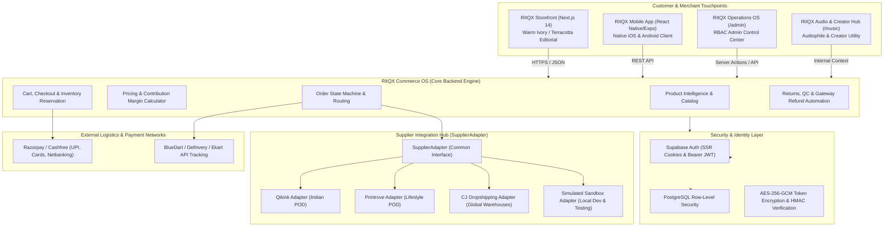

# RIIQX 2.0 — Master System Architecture
**Brand:** RIIQX — A New Perspective on Indian Living  
**Architecture:** Modern Indian Heritage D2C Commerce Platform & Intelligent Autonomous Infrastructure  
**Core Technologies:** Next.js 14 (App Router), React 18, TypeScript 5.6, Supabase PostgreSQL, Tailwind CSS, Framer Motion, React Native (Expo)  

---

## 1. End-to-End System Architecture



---

## 2. Core Functional Subsystems

### 2.1 The `SupplierAdapter` Abstraction
All supplier integrations adhere strictly to a standardized TypeScript contract:
```typescript
export interface SupplierAdapter {
  id: string;
  name: string;
  authenticate(): Promise<boolean>;
  testConnection(): Promise<{ ok: boolean; latencyMs: number }>;
  getProducts(params?: CatalogQuery): Promise<SupplierProduct[]>;
  getProductDetails(externalId: string): Promise<SupplierProductDetail>;
  getInventory(sku: string): Promise<InventoryLevel>;
  calculateShipping(params: ShippingCalcParams): Promise<ShippingEstimate>;
  createOrder(order: InternalOrderPayload): Promise<SupplierOrderResult>;
  getOrderStatus(supplierOrderId: string): Promise<SupplierOrderStatus>;
  cancelOrder(supplierOrderId: string, reason: string): Promise<boolean>;
  getTracking(supplierOrderId: string): Promise<TrackingDetails>;
  handleWebhook(payload: unknown, signature: string): Promise<WebhookResult>;
}
```

### 2.2 Order State Machine
1. `PENDING_PAYMENT` &rarr; Order created, inventory locked in `reserved_stock`.
2. `PAID` &rarr; Payment gateway HMAC signature verified on server.
3. `VALIDATING` &rarr; Address validated, pincode serviceability confirmed.
4. `SUPPLIER_ROUTING` &rarr; Cost, stock, and destination scored; optimal supplier chosen.
5. `AWAITING_SUPPLIER` &rarr; Order dispatched to partner API.
6. `SUPPLIER_ACCEPTED` &rarr; Partner confirms manufacturing/dispatch schedule.
7. `PROCESSING` &rarr; Sourcing/Printing/Packaging in progress.
8. `SHIPPED` &rarr; Waybill & tracking number generated (BlueDart/Delhivery).
9. `OUT_FOR_DELIVERY` &rarr; Courier out for final delivery milestone.
10. `DELIVERED` &rarr; Proof of delivery confirmed.
11. `REFUND_PENDING` / `REFUNDED` &rarr; Reverse-logistics triggered if requested within 7 days.

---

## 3. Database & Persistence Layer
Backed by PostgreSQL on Supabase (`ojtngzqsrdralrhipjzt`):
- All tables protected by strict Row-Level Security (RLS).
- Customers access only their own orders and cart items.
- Administrators granted access based on server-verified roles (`admin_roles`, `admin_users`).
