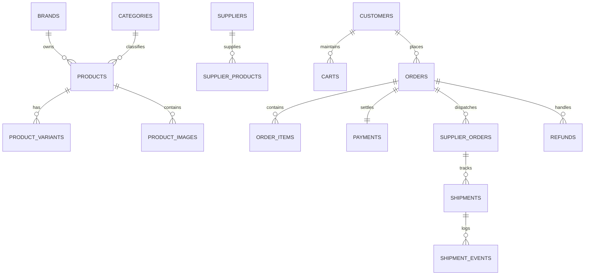

# RIIQX 2.0 — Relational Database Schema (PostgreSQL)
**Database Engine:** PostgreSQL 15+ on Supabase  
**Security Model:** Row-Level Security (RLS) on all user-facing tables  
**Primary Key Standard:** UUID (`gen_random_uuid()`) and prefix-encoded strings (e.g. `ord_...`, `prod_...`)  

---

## 1. Schema Architecture & Entity Relationship Diagram

---

## 2. Table Specifications

### 2.1 Core Identity & Administration
- `customers`: Customer identity linked to Supabase `auth.users(id)`. Attributes: `full_name`, `email`, `phone`, `default_shipping_address`, `gst_number` (optional B2B).
- `customer_addresses`: Multiple shipping/billing addresses with pincode validation.
- `admin_users` & `admin_roles`: Multi-role access control (`super_admin`, `catalog_manager`, `supplier_manager`, `operations_manager`, `support_agent`, `finance_analyst`).
- `audit_logs`: Immutable security ledger recording all critical administrative changes.

### 2.2 Sourcing & Supplier Hub
- `suppliers`: Registered partner entities (Qikink, Printrove, CJ, Artisanal Hubs). Fields: `company_name`, `api_endpoint`, `rating`, `shipping_days_min/max`, `return_policy`, `is_active`.
- `supplier_credentials`: AES-256-GCM encrypted tokens, client IDs, and webhook signing secrets.
- `supplier_products` & `supplier_variants`: Supplier-specific SKU mapping, wholesale costs, and inventory feeds.
- `inventory_snapshots`: Synchronized inventory levels with `available_stock`, `reserved_stock`, and `effective_stock`.

### 2.3 Product Catalog & Merchandising
- `product_categories`: Hierarchical categories (`RIIQX Objects`, `RIIQX Living`, `RIIQX Carry`, `RIIQX Everyday`).
- `products`: Public catalog items with editorial descriptions, material disclosures, country of origin (`India`), and contribution margin rules.
- `product_variants`: Size, color, finish, SKU, and price deltas.
- `product_images`: High-resolution lifestyle and product photography with alt tags.
- `pricing_rules`: Configurable markup formulas, minimum contribution thresholds, and tax rules.

### 2.4 Checkout, Orders & Fulfilment
- `carts` & `cart_items`: Ephemeral and persistent customer shopping bags.
- `orders`: Immutable order records with state transitions (`pending_payment`, `paid`, `supplier_routed`, `processing`, `shipped`, `delivered`, `cancelled`).
- `order_items`: Line items capturing historical unit price, COGS, and margin snapshot at moment of purchase.
- `payments`: Gateway transaction records (`razorpay_order_id`, `razorpay_payment_id`, `payment_method`, `signature_verified`).
- `supplier_orders`: Downstream POs dispatched to suppliers with partner confirmation IDs.
- `shipments` & `shipment_events`: Courier tracking milestones (BlueDart, Delhivery, Ekart).
- `refunds`: Gateway refund tracking and reverse logistics records.

