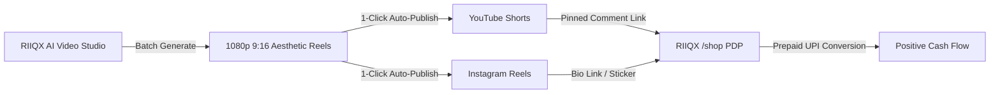

# RIIQX 2.0 — Zero-Ad-Spend Growth & Distribution Playbook

**Mission:** Build a sustainable, profitable D2C lifestyle startup without initial performance marketing capital.  
**Core Thesis:** Organic viral short-form video + Micro-creator affiliate partnerships + Deep SEO indexing.

---

## 1. The Autonomous 9:16 Video Flywheel

Performance ads (Meta Ads / Google Shopping) demand high initial cash burn. RIIQX leverages its own built-in **AI Video & Motion Studio** to produce daily viral content at ₹0 cost:

### 1.1 Proven Content Archetypes (High Organic Retention)
1. **"The Desk Reset" (ASMR / Sensory Focus):**
   - Visual: 15-second cinematic clip showing the Royal Brass Valet Tray and Teak Desk Mat placed on a clean wooden workspace.
   - Sound: Crisp mechanical keyboard clicks and tactile brass resonance.
   - Caption: *"The physical objects on your desk shape how clearly you think. Forged in solid brass in Moradabad. Available at link in bio. #DeskSetup #Minimalism #ModernIndianHeritage"*
2. **"Made in India vs Mass Produced" (Craft Storytelling):**
   - Visual: Macro shots of sand-cast brass beating and hand-turned Sheesham wood finishing.
   - Retention Hook: First 3 seconds: *"Why we stopped buying generic plastic desk organizers."*
3. **"Morning Coffee Ritual" (Lifestyle Warmth):**
   - Visual: Pour-over coffee into the Jodhpur Terracotta Ceramic Mug with morning sunlight.

---

## 2. Micro-Creator Affiliate Ecosystem

Instead of paying upfront influencer fees, RIIQX provides micro-creators (1,000–50,000 followers in tech, design, and interior decor) with a performance partnership:

* **Revenue Share:** 15% net commission on every delivered order.
* **Tracking Architecture:** Built directly into RIIQX (`?ref=username` referral engine with 30-day cookie window).
* **Creator Incentive:** Free sample gifted only after creator generates 3 confirmed sales or upon reaching 10k genuine views on a tagged reel.
* **Affiliate Portal:** Creators track clicks, conversions, and payouts in real-time.

---

## 3. Visual Search & Pinterest SEO

Desk aesthetics and home decor are heavily driven by visual search:
1. **Pinterest Rich Pins:** All 18 RIIQX launch SKUs are formatted as Pinterest Rich Product Pins showing live pricing and stock status.
2. **Google Shopping Free Listings:** Structured data schema (`schema.org/Product`) automatically renders price, availability, and merchant return policies in Google search results without Google Ads spending.

---

## 4. 90-Day Milestones to Sustainable Scale

| Timeline | Focus | Target Metric | Operational Rule |
| :--- | :--- | :--- | :--- |
| **Days 1–15** | Store launch, friends/family pilot, 1st 20 orders | ₹30,000 GMV | 100% Prepaid only; 0% debt |
| **Days 16–45** | Daily 2x Shorts/Reels via RIIQX Video Studio | 50,000 Video Views / month | Organic reach testing |
| **Days 46–90** | Onboard 25 micro-creators; add 10 new SKUs | ₹1,50,000 Monthly GMV | Reinvest 50% of net margin into inventory buffer |

