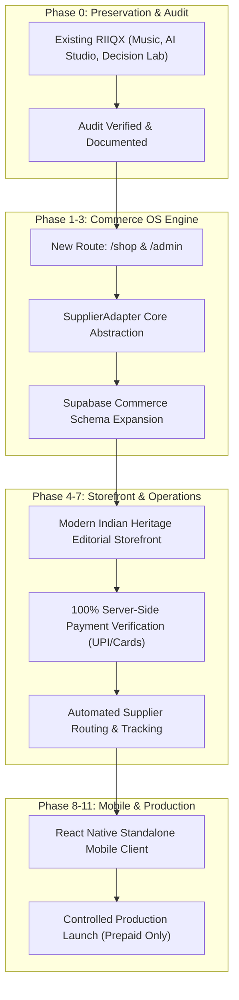

# RIIQX 2.0 — Non-Destructive Migration Plan & Source-of-Truth Matrix
**Target State:** RIIQX 2.0 Modern Indian Heritage D2C Commerce Platform  
**Preservation Mandate:** 100% preservation of existing live production website (`https://riiqx.vercel.app`), Supabase database, and active routes.  

---

## 1. Source-of-Truth Matrix

| Domain / Entity | Current Source of Truth | Target Source of Truth (RIIQX 2.0) | Migration Protocol |
| :--- | :--- | :--- | :--- |
| **Product Catalogue** | `src/services/shopping/commerce-service.ts` & Supabase `marketplace_products` | Supabase `products` + `product_variants` (PostgreSQL) | Non-destructive schema expansion; legacy records retained with `data_source = 'legacy_catalog'` |
| **Inventory & Stock** | In-memory `inventoryStore` + `supplier_inventory_sync` | Supabase `inventory_snapshots` & Supplier Webhooks | Real-time delta sync with reserve locks during checkout |
| **Order Lifecycle** | In-memory `ordersStore` + `dropshipping_orders` | Supabase `orders` + `order_items` + `supplier_orders` | Strict PostgreSQL state transitions with immutable event ledger |
| **Customer Identity** | Supabase Auth (`auth.users`) & `profiles` | Supabase Auth (`auth.users`) & `customer_profiles` | Zero disruption; existing user IDs seamlessly inherit customer profile attributes |
| **Payment Verification** | Stub / Client-side checkout | Server-side verified Razorpay/Cashfree Webhook HMAC | Webhook signature check required before any order transitions from `pending_payment` to `paid` |
| **Shopify Integration** | External standalone (if configured) | Optional Connected Supplier / Sales Channel via `SupplierAdapter` | Never dual-write without explicit external order ID synchronization |

---

## 2. Phased Non-Destructive Rollout Strategy

### Invariant Rules During Migration:
1. **Route Separation:** Existing root `/` and `/music` views remain untouched until the new `/shop` storefront is tested and approved for root elevation.
2. **Database Integrity:** No `DROP TABLE` or destructive SQL scripts will be executed on the linked Supabase project `ojtngzqsrdralrhipjzt`. All schema additions will be additive with safe `IF NOT EXISTS` clauses.
3. **Rollback Switch:** A feature flag `NEXT_PUBLIC_COMMERCE_STOREFRONT_ENABLED` will control whether `/shop` or the legacy workspace view is default.

