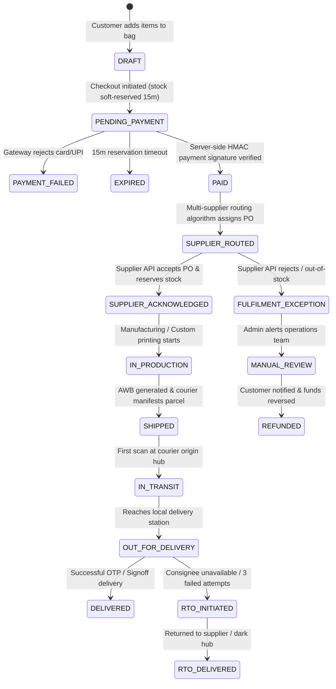

# RIIQX 2.0 — Order State Machine & Event Specification

**Architecture Standard:** Deterministic, Event-Driven, Idempotent  
**Execution Context:** RIIQX Commerce OS (Next.js Edge/Node + Supabase PostgreSQL)  
**Primary Invariant:** Zero unbacked stock commitments; 100% prepaid settlement before supplier dispatch.

---

## 1. High-Level State Transition Diagram



---

## 2. State Definitions & Trigger Events

| State | Allowed Next States | Trigger Event | Automated Action | Customer Communication |
| :--- | :--- | :--- | :--- | :--- |
| `DRAFT` | `PENDING_PAYMENT` | User clicks "Proceed to Checkout" | Validates prices, calculates shipping & GST | None |
| `PENDING_PAYMENT` | `PAID`, `PAYMENT_FAILED`, `EXPIRED` | Gateway webhook or client redirect | Initiates Razorpay order; locks price for 15m | In-app checkout sheet |
| `PAID` | `SUPPLIER_ROUTED`, `CANCELLED` | HMAC SHA-256 signature verification | Creates immutable transaction ledger record | Instant WhatsApp + Email receipt |
| `SUPPLIER_ROUTED` | `SUPPLIER_ACKNOWLEDGED`, `FULFILMENT_EXCEPTION` | `SupplierAdapter.createOrder()` dispatched | Maps internal SKU to supplier SKU; sends PO | "Artisan partner received order" |
| `SUPPLIER_ACKNOWLEDGED` | `IN_PRODUCTION`, `CANCELLED` | Supplier webhook or poll ACK | Records external PO number in Supabase | "Crafting your heritage piece" |
| `IN_PRODUCTION` | `SHIPPED` | Quality check passed | Verifies packaging seal & dustbag standard | Progress timeline update |
| `SHIPPED` | `IN_TRANSIT` | Courier generates AWB (BlueDart/Delhivery) | Registers tracking webhook; logs initial scan | SMS/WhatsApp with live tracking link |
| `IN_TRANSIT` | `OUT_FOR_DELIVERY` | Courier milestone events | Continuously mirrors tracking checkpoints | In-app order tracking card |
| `OUT_FOR_DELIVERY` | `DELIVERED`, `RTO_INITIATED` | Final delivery run scan | Alerts customer to be available | "Out for delivery today" SMS |
| `DELIVERED` | `RETURN_REQUESTED`, `ARCHIVED` | Delivery OTP / Proof-of-delivery | Closes active lifecycle; opens 48h defect window | "Enjoy your RIIQX piece" message |
| `FULFILMENT_EXCEPTION` | `MANUAL_REVIEW`, `REFUNDED` | Out-of-stock or supplier rejection | Escalates to `/admin` exceptions queue | "Priority dispatch update" email |
| `REFUNDED` | `[*] (Terminal)` | Admin / Automated refund API | Gateway API reverses funds to source account | Instant refund ARN confirmation |

---

## 3. Idempotency & Concurrency Rules

1. **Payment Verification Idempotency:**
   - Every payment confirmation requires an `idempotencyKey` formatted as `rzp_verify_${orderId}_${paymentId}`.
   - If multiple duplicate webhooks arrive from the payment gateway, subsequent calls verify the cached state and return the existing record without re-dispatching supplier POs.
2. **Double-Routing Prevention:**
   - Downstream supplier orders enforce a database unique constraint on `(order_id, supplier_id)`.
   - The state machine uses atomic PostgreSQL update statements:
     ```sql
     UPDATE public.riiqx_commerce_orders
     SET status = 'awaiting_supplier', updated_at = NOW()
     WHERE id = :orderId AND status = 'paid'
     RETURNING *;
     ```
   - Only the single execution thread that successfully transitions `paid` -> `awaiting_supplier` acquires the right to call `adapter.createOrder()`.

---

## 4. Reverse Logistics & RTO Mitigation Protocol

* **Prepayment Filter:** Zero COD eliminates the primary driver of Indian D2C RTO (which averages 28–35% in apparel).
* **Address Hygiene Gate:**
  - Pincode verified against the master Indian Postal Service database before checkout initiation.
  - Automated detection of missing landmarks or invalid phone formats (`+91` 10-digit validation).
* **Damaged in Transit Protocol:**
  - 48-hour unboxing defect reporting window with photo upload in the support hub.
  - Automated supplier RMA creation for verified courier transit damage.

